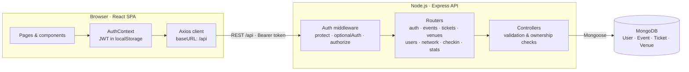
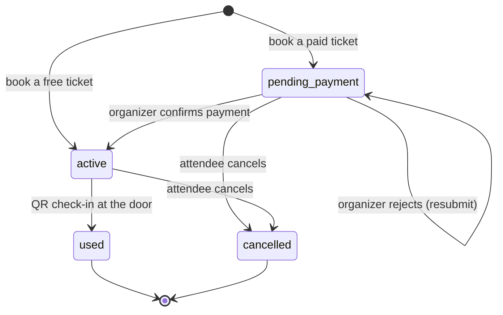

<div align="center">


# EventHub

**A full-stack event management platform for organizers and attendees.**

Discover events · Sell tickets · Verify UPI payments · Scan attendees in with QR codes · Build a community

[](https://react.dev)
[](https://vitejs.dev)
[](https://nodejs.org)
[](https://expressjs.com)
[](https://www.mongodb.com)
[](LICENSE)
[](#contributing)

</div>

---

## Overview

EventHub is a MERN stack application that covers the full life of an event: an organizer publishes
an event with tiered tickets, attendees book and pay over UPI, the organizer verifies each payment,
a QR-coded ticket is issued on confirmation, and staff scan it at the door with live attendance
stats. Alongside that, attendees can browse a calendar, discover venues, review them, and connect
with other people in the community.

Built with **JWT authentication**, **role-aware authorization**, and a design system that works from
mobile to desktop.

## Table of contents

- [Features](#features)
- [Tech stack](#tech-stack)
- [Architecture](#architecture)
- [Ticket & payment lifecycle](#ticket--payment-lifecycle)
- [Project structure](#project-structure)
- [Getting started](#getting-started)
- [Demo accounts](#demo-accounts)
- [Environment variables](#environment-variables)
- [API reference](#api-reference)
- [Available scripts](#available-scripts)
- [Quality checks](#quality-checks)
- [Deployment](#deployment)
- [Security notes](#security-notes)
- [Roadmap](#roadmap)
- [Contributing](#contributing)
- [License](#license)
- [Author](#author)

## Features

<table>
<tr><th width="160">Area</th><th>What it does</th></tr>
<tr>
<td><b>Events</b></td>
<td>Create, edit and delete events · drafts that stay private until published · 11 categories · online or in-person · cover art, tags, languages, age limits and requirements · full-text search with category and date filters · pagination · interactive month calendar</td>
</tr>
<tr>
<td><b>Ticketing</b></td>
<td>Multiple ticket tiers per event · independent inventory per tier · free and paid tiers · QR-coded tickets · cancellation with inventory release · duplicate-booking protection</td>
</tr>
<tr>
<td><b>Payments</b></td>
<td>UPI collection to the organizer's own UPI ID · QR generated per booking · attendee submits the transaction reference · organizer confirms or rejects · revenue counted only after confirmation</td>
</tr>
<tr>
<td><b>Check-in</b></td>
<td>Paste a ticket ID or raw QR payload to check someone in · live attendance percentage · recent check-in feed · wrong-event and double-entry protection</td>
</tr>
<tr>
<td><b>Venues</b></td>
<td>Venue directory with capacity, amenities, pricing, map links and contact details · star reviews with running average · likes · upcoming and ongoing events per venue</td>
</tr>
<tr>
<td><b>Networking</b></td>
<td>People directory with search · connection requests · accept or decline · connection lists · interest and location-based suggestions</td>
</tr>
<tr>
<td><b>Accounts</b></td>
<td>Individual or organization profiles · organizer UPI setup · profile and password management · JWT sessions that survive reloads</td>
</tr>
<tr>
<td><b>Dashboard</b></td>
<td>Role-aware overview of events, revenue, tickets sold and upcoming activity · attendee list with payment verification actions · account settings</td>
</tr>
</table>

### Who can do what

| Capability | Visitor | Attendee | Organizer | Admin |
| --- | :---: | :---: | :---: | :---: |
| Browse events, venues, calendar | ✅ | ✅ | ✅ | ✅ |
| Book tickets, view own QR codes | — | ✅ | ✅ | ✅ |
| Create and manage events | — | — | ✅ | ✅ |
| Verify payments and check attendees in | — | — | ✅ | ✅ |
| Review and like venues | — | ✅ | ✅ | ✅ |
| Send and accept connections | — | ✅ | ✅ | ✅ |
| View drafts of other organizers | — | — | — | ✅ |

## Tech stack

| Layer | Technology |
| --- | --- |
| **Frontend** | React 19, React Router 7, Vite 7, Axios, date-fns, react-hot-toast, react-icons, html5-qrcode, qrcode |
| **Backend** | Node.js 18+, Express 4, Mongoose 8, JWT (`jsonwebtoken`), bcryptjs, qrcode, uuid |
| **Database** | MongoDB (Atlas or local) |
| **Styling** | Hand-written CSS with a token-based design system (no UI framework) |
| **Hosting** | Vercel for both apps (serverless Express + static SPA) |

## Architecture



**Design decisions worth knowing**

- **Ownership is enforced server-side** on every mutation — events, venues, tickets and check-in all
  compare the resource owner against the authenticated user, with admin override.
- **Dates are calendar dates.** Events store a date (UTC midnight) plus separate start/end time
  strings; the UI formats them in UTC so the day never shifts for viewers in other timezones.
- **The API is origin-agnostic.** The frontend calls a relative `/api` path — Vite proxies it in
  development, and a single `VITE_API_URL` points it elsewhere when the apps are hosted separately.

## Ticket & payment lifecycle



> Inventory is reserved only when a ticket becomes `active`, so abandoned payments never block
> other attendees.

## Project structure

```text
.
├── backend/
│   ├── controllers/       # Route handlers: auth, events, tickets, venues, network, check-in, stats
│   ├── middleware/        # JWT protect / authorize / optionalAuth
│   ├── models/            # Mongoose schemas: User, Event, Ticket, Venue
│   ├── routes/            # Express routers mounted under /api
│   ├── seed.js            # Demo data seeder
│   ├── server.js          # App bootstrap: CORS, DB connection, error handling
│   └── vercel.json        # Serverless entry
├── frontend/
│   ├── public/            # Static assets (favicon)
│   ├── src/
│   │   ├── components/    # Navbar, EventCard, PaymentModal
│   │   ├── context/       # AuthProvider + useAuth
│   │   ├── pages/         # Route-level screens (16)
│   │   ├── services/      # Axios instance and typed API helpers
│   │   └── utils/         # Date and text formatting helpers
│   └── vercel.json        # SPA rewrites
├── docs/                  # README assets
└── README.md
```

## Getting started

### Prerequisites

- **Node.js 18+** and npm
- A **MongoDB** database — [Atlas free tier](https://www.mongodb.com/cloud/atlas/register) or a local `mongod`

### 1 · Backend

```bash
cd backend
npm install
cp .env.example .env      # then fill in MONGO_URI and JWT_SECRET
npm run seed              # optional: load demo users, venues, events and tickets
npm run dev               # http://localhost:5000
```

Confirm it is up: `GET http://localhost:5000/api/health`

### 2 · Frontend

```bash
cd frontend
npm install
npm run dev               # http://localhost:3000
```

The dev server proxies `/api` to `http://localhost:5000`, so no API URL is needed locally. For a
deployed build, set `VITE_API_URL` (see [Environment variables](#environment-variables)).

### 3 · Sign in

Register a new account, or use one of the seeded [demo accounts](#demo-accounts).

## Demo accounts

Created by `npm run seed`. Every account uses the password **`password123`**.

| Role | Email | Notes |
| --- | --- | --- |
| Organizer | `alice@eventhub.com` | Organization account with a UPI ID and 5 events |
| Attendee | `bob@eventhub.com` | Holds confirmed tickets |
| Attendee | `carol@eventhub.com` | Holds a ticket and a pending connection request |
| Admin | `admin@eventhub.com` | Full access, including other organizers' drafts |

## Environment variables

### Backend — `backend/.env`

| Variable | Required | Default | Description |
| --- | :---: | --- | --- |
| `MONGO_URI` | ✅ | — | MongoDB connection string |
| `JWT_SECRET` | ✅ | — | Signing secret for access tokens (`openssl rand -hex 32`) |
| `JWT_EXPIRE` | — | `7d` | Access token lifetime |
| `PORT` | — | `5000` | Port the API listens on (local development) |
| `CLIENT_URL` | — | — | Frontend origin(s) allowed by CORS, comma-separated |
| `CLIENT_URLS` | — | — | Additional allowed origins, merged with `CLIENT_URL` |
| `NODE_ENV` | — | `development` | Set to `production` on Vercel so the app exports instead of listening |

> **CORS:** browsers send an `Origin` header even on same-origin POSTs, so every origin that serves
> the app must be listed — production domain, preview deployments and `http://localhost:3000`.

### Frontend — `frontend/.env.local`

| Variable | Required | Description |
| --- | :---: | --- |
| `VITE_API_URL` | Deployed builds | Absolute API base including `/api`, e.g. `https://api.example.com/api`. Leave unset to use the same origin. |

## API reference

Base URL: `/api` · Protected routes require `Authorization: Bearer <token>`.

<details>
<summary><b>Authentication</b></summary>

| Method | Endpoint | Access | Description |
| --- | --- | --- | --- |
| `POST` | `/auth/register` | Public | Create an individual or organization account |
| `POST` | `/auth/login` | Public | Exchange credentials for a JWT |
| `GET` | `/auth/me` | Auth | Current user with connections |
| `PUT` | `/auth/profile` | Auth | Update profile fields |
| `PUT` | `/auth/upi` | Auth | Set the organizer UPI ID |
| `PUT` | `/auth/password` | Auth | Change password |

</details>

<details>
<summary><b>Events</b></summary>

| Method | Endpoint | Access | Description |
| --- | --- | --- | --- |
| `GET` | `/events` | Public | List events — `search`, `category`, `tags`, `startFrom`, `startTo`, `isOnline`, `sort`, `page`, `limit` |
| `GET` | `/events/calendar` | Public | Published events for a `month` / `year` |
| `GET` | `/events/my` | Auth | Events owned by the caller |
| `GET` | `/events/:id` | Public | Event detail (drafts visible to owner/admin only) |
| `POST` | `/events` | Auth | Create an event |
| `PUT` | `/events/:id` | Owner/Admin | Update an event |
| `DELETE` | `/events/:id` | Owner/Admin | Delete an event |
| `POST` | `/events/:id/like` | Auth | Toggle like |
| `POST` | `/events/:id/comments` | Auth | Add a comment |

</details>

<details>
<summary><b>Tickets</b></summary>

| Method | Endpoint | Access | Description |
| --- | --- | --- | --- |
| `POST` | `/tickets/book` | Auth | Reserve a ticket (free tickets are confirmed immediately) |
| `GET` | `/tickets/my` | Auth | Caller's tickets |
| `GET` | `/tickets/:id` | Attendee/Organizer/Admin | Ticket detail |
| `GET` | `/tickets/event/:eventId` | Organizer/Admin | All tickets for an event |
| `POST` | `/tickets/:id/submit-payment` | Attendee | Submit the UPI transaction reference |
| `POST` | `/tickets/:id/confirm-payment` | Organizer/Admin | Confirm payment and issue the QR ticket |
| `POST` | `/tickets/:id/reject-payment` | Organizer/Admin | Reject a submission so it can be corrected |
| `DELETE` | `/tickets/:id` | Attendee | Cancel a ticket |

</details>

<details>
<summary><b>Check-in</b></summary>

| Method | Endpoint | Access | Description |
| --- | --- | --- | --- |
| `POST` | `/checkin/scan` | Organizer/Admin | Check in by `ticketId`, optionally scoped to `eventId` |
| `GET` | `/checkin/event/:eventId/stats` | Organizer/Admin | Attendance totals, percentage and recent check-ins |

</details>

<details>
<summary><b>Venues</b></summary>

| Method | Endpoint | Access | Description |
| --- | --- | --- | --- |
| `GET` | `/venues` | Public | List venues — `search`, `city`, `minCapacity`, `maxCapacity` |
| `GET` | `/venues/:id` | Public | Venue detail with upcoming and ongoing events |
| `POST` | `/venues` | Auth | Create a venue |
| `PUT` | `/venues/:id` | Owner/Admin | Update a venue |
| `DELETE` | `/venues/:id` | Owner/Admin | Delete a venue |
| `POST` | `/venues/:id/review` | Auth | Add a star review |
| `POST` | `/venues/:id/like` | Auth | Toggle like |

</details>

<details>
<summary><b>People & networking</b></summary>

| Method | Endpoint | Access | Description |
| --- | --- | --- | --- |
| `GET` | `/users` | Auth | People directory — `search`, `interests`, `page` |
| `GET` | `/users/:id` | Auth | Public profile |
| `GET` | `/users/:id/events` | Auth | Events a user has tickets for |
| `GET` | `/network/connections` | Auth | Connections and pending requests |
| `GET` | `/network/suggestions` | Auth | Suggested people by shared interests or location |
| `GET` | `/network/attendees/:eventId` | Auth | Attendees of an event |
| `POST` | `/network/connect/:userId` | Auth | Send a connection request |
| `PUT` | `/network/accept/:userId` | Auth | Accept a request |
| `PUT` | `/network/decline/:userId` | Auth | Decline a request |
| `DELETE` | `/network/disconnect/:userId` | Auth | Remove a connection |

</details>

<details>
<summary><b>Statistics</b></summary>

| Method | Endpoint | Access | Description |
| --- | --- | --- | --- |
| `GET` | `/stats` | Public | Platform totals — events, users, tickets, venues |
| `GET` | `/stats/organizer` | Auth | Tickets sold and revenue for the caller's events |
| `GET` | `/health` | Public | Health probe |

</details>

## Available scripts

| Location | Command | Description |
| --- | --- | --- |
| `backend` | `npm run dev` | Start the API with Nodemon |
| `backend` | `npm start` | Start the API |
| `backend` | `npm run seed` | Reset and repopulate demo data |
| `frontend` | `npm run dev` | Start the Vite dev server |
| `frontend` | `npm run build` | Build the production bundle |
| `frontend` | `npm run preview` | Serve the production build locally |
| `frontend` | `npm run lint` | Run ESLint |

## Quality checks

Both apps are kept clean and buildable:

```bash
cd frontend && npm run lint && npm run build   # 0 lint problems, production build succeeds
cd backend  && npm start                        # requires MONGO_URI
```

The frontend uses the React 19 hooks lint rules, so effects, dependency arrays and component
exports are all validated.

## Deployment

Both halves deploy to **Vercel** from the same repository — set the root directory per project.

### Backend

1. Import the repository, set **Root Directory** to `backend`.
2. `vercel.json` routes all traffic to `server.js`, which exports the Express app when
   `NODE_ENV=production`.
3. Add environment variables: `MONGO_URI`, `JWT_SECRET`, `JWT_EXPIRE`, `CLIENT_URL` (the frontend origin).

### Frontend

1. Import the repository, set **Root Directory** to `frontend`.
2. Add `VITE_API_URL=https://<your-api>.vercel.app/api` as a build-time variable.
3. `vercel.json` rewrites all paths to `index.html` for client-side routing.

> After the frontend gets its final URL, add it to the backend's `CLIENT_URL` — otherwise browser
> writes (signup, booking, reviews) will be rejected by CORS while reads still work.

## Security notes

- Passwords are hashed with **bcrypt (cost 12)** and never returned by the API.
- JWTs are signed with `JWT_SECRET`; rotating it invalidates every session.
- Every mutation verifies resource ownership server-side; drafts are hidden from other users.
- `JWT_SECRET` and `MONGO_URI` belong in environment configuration only. `.env` files are gitignored —
  commit the `.env.example` templates instead.
- Payments are verified manually by the organizer against their own UPI account; it is not a
  payment gateway integration.

## Roadmap

- [ ] Gateway-based payments (Razorpay/Stripe) alongside manual UPI verification
- [ ] Password reset and email verification
- [ ] Reminder emails before events
- [ ] Bulk ticket export (CSV) for organizers
- [ ] Automated test coverage for the API
- [ ] Self-service venue booking with date-conflict checks

## Contributing

Issues and pull requests are welcome.

1. Fork the repository and create a branch: `git checkout -b feature/your-feature`
2. Keep changes focused and run `npm run lint` in `frontend` before committing.
3. Describe the problem and the solution in your pull request.

## License

Released under the **ISC License** — see [LICENSE](LICENSE) for details.

## Author

**N S Karthik Samak**

[](https://github.com/karthiksamak-git)

<div align="center">
<sub>If EventHub was useful to you, consider giving the repository a ⭐</sub>
</div>
